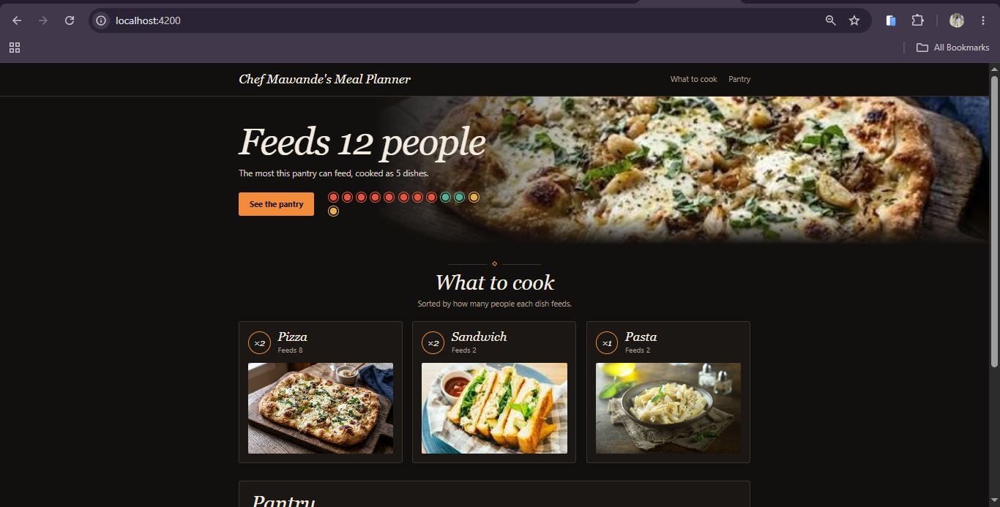
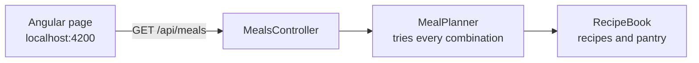
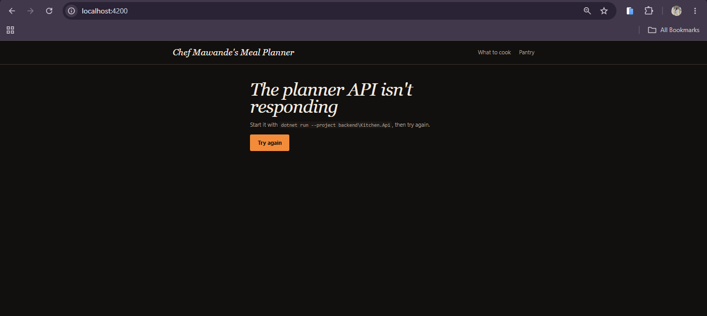
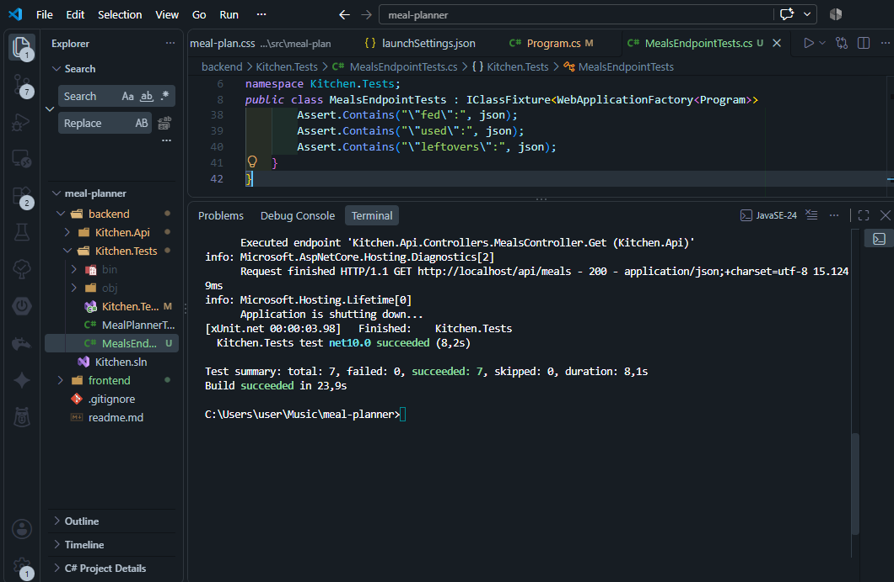
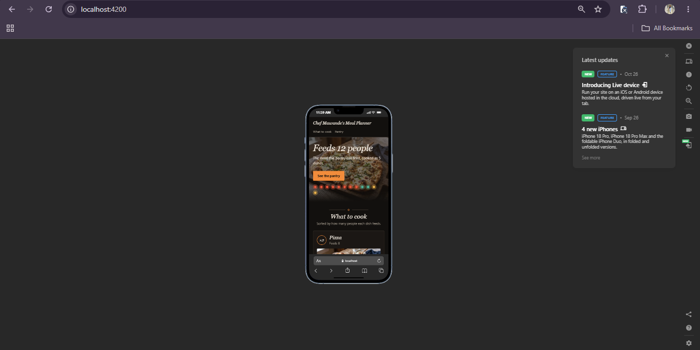

<div align="center">

# 🍽️ Chef Mawande’s Meal Planner

**Given a pantry and a recipe book, what is the most people we can feed?**




</div>

> [!TIP]
> 📖 **Want more detail?** The [project wiki](https://github.com/MawandeM-98/meal-planner/wiki) has a worked example of the search, a decision log, the API reference and a guide to how the tests work.

---

## 🎯 The challenge

> Given the available ingredients shown and the list of recipes below, determine the optimal combination of foods that can be created in order to feed as many people as possible.

**Recipes**

| Dish | Feeds | Ingredients |
|---|:---:|---|
| Burger | 1 | 1 meat, 1 lettuce, 1 tomato, 1 cheese, 1 dough |
| Pie | 1 | 2 dough, 2 meat |
| Sandwich | 1 | 1 dough, 1 cucumber |
| Pasta | 2 | 2 dough, 1 tomato, 2 cheese, 1 meat |
| Salad | 3 | 2 lettuce, 2 tomato, 1 cucumber, 2 cheese, 1 olives |
| Pizza | 4 | 3 dough, 2 tomato, 3 cheese, 1 olives |

**Pantry**

| Cucumber | Olives | Lettuce | Meat | Tomato | Cheese | Dough |
|:---:|:---:|:---:|:---:|:---:|:---:|:---:|
| 2 | 2 | 3 | 6 | 6 | 8 | 10 |

---

## 🏆 The answer

**The most people this pantry can feed is 12.**

The plan I picked: **2 Sandwich, 1 Pasta and 2 Pizza.**
That leaves 3 lettuce, 5 meat and 1 tomato in the pantry.

### Five different plans reach 12

There is no single best plan. Five combinations all feed 12 people:

| Plan | What to cook | Dishes cooked | Ingredient units used |
|:---:|---|:---:|:---:|
| **A ✅** | **2 Sandwich, 1 Pasta, 2 Pizza** | **5** | **28** |
| B | 2 Burger, 2 Sandwich, 2 Pizza | 6 | 32 |
| C | 1 Burger, 2 Pie, 1 Pasta, 1 Salad, 1 Pizza | 6 | 36 |

*Ingredient units* is the total number of ingredients a plan uses. A pizza, for example, uses 9.

### Why Plan A

When several plans tie, I selected the one that **cooks the fewest dishes**: 5 instead of 6. Less cooking, fewer things to manage, and the least effort for the same result. It also turns out to use the fewest ingredients (28 against 32 to 36), so the plan that is simplest to cook is also the most efficient.

The code applies the tie-break on dishes cooked. If two plans tie on that as well, the first one found is kept.

---

## 🧠 How it works

The solution is :

1. Take the recipes in order: Burger, Pie, Sandwich, Pasta, Salad, Pizza.
2. For each recipe, try making 0, 1, 2 and so on, for as long as the pantry still has the ingredients.
3. After each choice, move on to the next recipe with whatever is left.
4. When every recipe has been decided, count the people fed. Keep the best plan seen: most people first, then fewest dishes.
5. When the search backs up to try something else, the ingredients are handed back to the pantry.

---

## 🏗️ Architecture



```
meal-planner/
├── backend/
│   ├── Kitchen.sln
│   ├── Kitchen.Api/
│   │   ├── Controllers/MealsController.cs   one GET endpoint
│   │   ├── Models/                          Recipe, MealPlan
│   │   ├── Services/MealPlanner.cs          the search
│   │   ├── Data/RecipeBook.cs               recipes and pantry from the brief
│   │   └── Program.cs                       wiring and CORS
│   └── Kitchen.Tests/                       xUnit unit and endpoint tests
└── frontend/                                Angular app
    ├── public/images/                       dish photos and README screenshots
    └── src/app/                             service and meal plan page
```

---

## 🚀 Running the project

### What you need

| Tool | Version used | Notes |
|---|---|---|
| .NET SDK | 10.0 | Check with `dotnet --version` |
| Node.js | 24.15.0 | 20.19 or newer also works. Check with `node --version` |
| Angular | 21 | Installed by `npm install`, so no global Angular CLI is needed |
| Git | any recent version | |

### Get the code

```bash
git clone https://github.com/MawandeM-98/meal-planner.git
cd meal-planner
```

The project runs in **three separate terminals**, all opened in the `meal-planner` folder. The backend and the frontend each keep running, so each needs a terminal of its own.

### Terminal 1: the API

```bash
dotnet run --project backend/Kitchen.Api
```

Wait for `Now listening on: http://localhost:5080`. To check it, open <http://localhost:5080/api/meals> and you should see the plan as JSON. Leave this terminal running.

### Terminal 2: the frontend

```bash
cd frontend
npm install
npm start
```

`npm install` is only needed the first time. Wait for `Application bundle generation complete`, then open <http://localhost:4200>.

Start the API first. If the frontend is running but the API isn't, the page shows this error with a **Try again** button:



Start Terminal 1, then press **Try again**.

### Terminal 3: the tests

```bash
dotnet test backend/Kitchen.Tests
```

All 7 tests should pass. The tests start their own copy of the API in memory, so they don't need Terminal 1. Stop the API first if you changed backend code, because Windows locks the file while the API is running. A successful run looks like this:



| What | Address |
|---|---|
| Web page | <http://localhost:4200> |
| API | <http://localhost:5080/api/meals> |

Stop either server with `Ctrl+C`.

<details>
<summary><b>Troubleshooting</b></summary>

- **The page says the API isn't responding.** Start Terminal 1, then press *Try again*. See the screenshot in Terminal 2 above.
- **The dish photos don't show.** The photos must be in `frontend/public/images/` and named `pizza.jpg`, `pasta.jpg` and `sandwich.jpg`. After changing `angular.json`, restart `npm start`, then hard-refresh with `Ctrl+Shift+R`.
- **`npm install` fails.** Check `node --version` and update Node if it is below 20.19.
- **A port is already in use.** Something else is on 5080 or 4200. Close it, or stop an older copy of the app.
- **`dotnet test` says a file is in use.** Stop the API in Terminal 1 and run the tests again.

</details>

---

## 📱 Desktop and mobile

The page is responsive. On a phone the dish cards stack into one column, the pantry list becomes a single column and the header wraps.

<table>
  <tr>
    <td align="center"><b>Desktop</b></td>
    <td align="center"><b>Mobile</b></td>
  </tr>
  <tr>
    <td align="center"></td>
    <td align="center"></td>
  </tr>
</table>

---

## 🧪 Tests

The tests live in `backend/Kitchen.Tests` and use [xUnit](https://xunit.net/).

| Test | What it protects |
|---|---|
| `FeedsTwelvePeopleWithTheGivenIngredients` | The headline answer: 12 |
| `OnATieCooksTheFewestDishes` | The tie-break: 5 dishes |
| `DishesAddUpToTheTotal` | Per-dish numbers add up to the total |
| `NeverUsesMoreThanThePantryHolds` | No ingredient is overspent |
| `FeedsNobodyWhenThePantryIsEmpty` | The empty-pantry edge case |
| `GetMeals_ReturnsTheBestPlan` | The real endpoint returns the 12-person plan |
| `GetMeals_UsesTheFieldNamesTheFrontendReads` | The JSON keeps the shape the page relies on |

The Angular page has no automated tests. The logic that matters lives in the planner in the backend, and the page only displays what the API returns.

---

## 🔌 API

`GET /api/meals` returns the best plan:

```json
{
  "totalFed": 12,
  "dishes": [
    { "name": "Sandwich", "count": 2, "fed": 2 },
    { "name": "Pasta", "count": 1, "fed": 2 },
    { "name": "Pizza", "count": 2, "fed": 8 }
  ],
  "used":      { "Cucumber": 2, "Olives": 2, "Lettuce": 0, "Meat": 1, "Tomato": 5, "Cheese": 8, "Dough": 10 },
  "leftovers": { "Cucumber": 0, "Olives": 0, "Lettuce": 3, "Meat": 5, "Tomato": 1, "Cheese": 0, "Dough": 0 }
}
```

---

## 🤝 Use of AI

This project was built with AI assistance (Claude, by Anthropic), used deliberately and under human oversight.

| | |
|---|---|
| **Where AI helped** | Parts of the code implementation (the planner and API, as well as one Services file containing business logic), the page styling, the unit and endpoint tests, and this documentation on the readme.md as well as the Wiki page |
| **What stayed human** | Parts of the backend implementation and code, Choosing the approach and the tie-break rule, setting up the repository by hand, picking the visual direction and the dish photos,running and debugging everything locally as well as the bulk of Angular coding |

How it was kept safe:

- Every piece of generated code was run locally before it was committed.
- The planner's behaviour is pinned down by automated tests, so it isn't trusted on sight.
- No credentials, secrets or personal data are in this repository.

More detail on the process is on the [wiki](https://github.com/MawandeM-98/meal-planner/wiki).

---

## 📸 Credits

(pictures sought from Google)

Will be deployed on Render soon by 27 October 2026 to accomodate both Angular and .Net files*

Did not utilize best practices of coding on Develop branch and merging to Main at the end :(.

Built by Mawande Msomi.